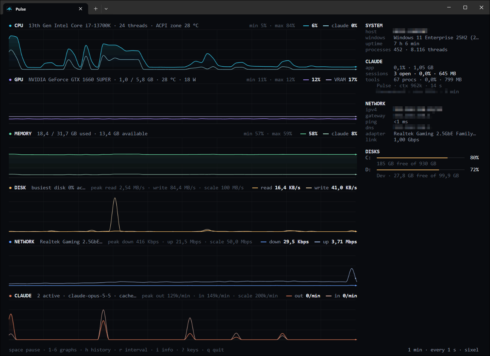
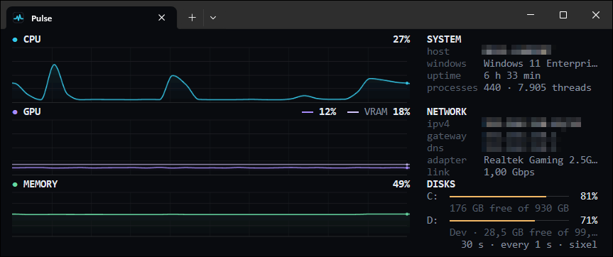
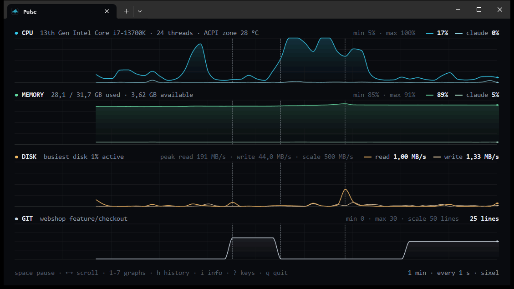
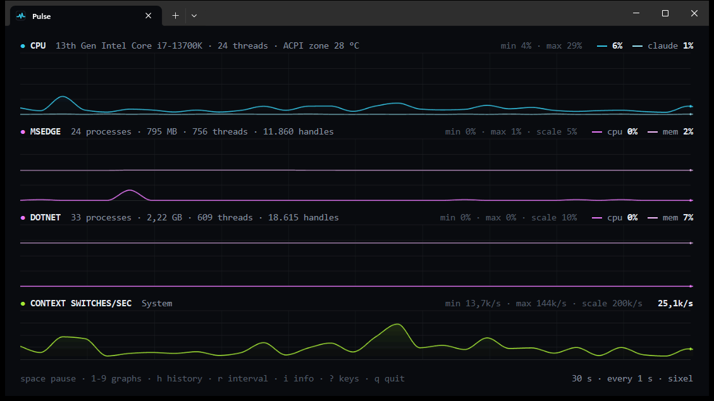

<p align="center">
  
</p>

<h1 align="center">Pulse</h1>

<p align="center">
  A system monitor for Windows Terminal (and Linux terminals) that looks like an oscilloscope.<br>
  CPU, GPU, memory, disk and network as smooth, scrolling traces, right in your terminal tab.
</p>

<p align="center">
  
</p>

## Why Pulse

- **Real graphics in the terminal.** Anti-aliased curves with a soft gradient underneath, drawn as Sixel pixels.
  No blocky character graphs.
- **Everything at a glance.** Live graphs for the hardware, plus a side panel with disk space, IP addresses and system info.
- **Your process, any counter, any server.** Follow one process or any Windows performance counter as a graph of its
  own, or watch another Windows machine over the network.
- **See what Claude does to your machine.** Tokens per minute of your Claude Code sessions on the same time axis as
  CPU and memory, with Claude's own share drawn in, so a build an agent starts is visible the moment it happens.
- **See what happened when.** Commits, checkouts and Windows errors are marked across every graph. Point at a spike
  to see which processes caused it, scroll back with the arrow keys, or record a run and play it back later.
- **Measure a command.** `tpulse -- dotnet build` runs the build in your shell, marks its start and end on the
  graphs and tells you afterwards what it cost: CPU, memory, disk, network and the busiest processes.
- **Light and private.** About 5 % of one CPU core. No admin rights, no drivers, no internet requests.

## Install

You need Windows 10 or 11, [Windows Terminal](https://aka.ms/terminal) 1.22 or later and the
[.NET 10 SDK](https://dotnet.microsoft.com/download/dotnet/10.0). Clone this repository, then run from its folder:

```powershell
./install.ps1
```

Open Windows Terminal and pick **Pulse** from the **+** menu, or just type `tpulse`.

The installer works for your user only. It adds the program, a PATH entry, a Windows Terminal profile and a
Start menu shortcut, and `./install.ps1 -Uninstall` removes them again. If PowerShell refuses to run scripts, use
`powershell -ExecutionPolicy Bypass -File install.ps1`.

### Linux

The terminal monitor runs on Linux too (x86_64 and aarch64), in any terminal; with Sixel support (foot, WezTerm,
Konsole, xterm -ti vt340, recent tmux) the graphs are pixels, elsewhere braille. You need the
[.NET 10 SDK](https://dotnet.microsoft.com/download/dotnet/10.0). Clone this repository, then run from its folder:

```bash
./install.sh
```

It puts the program in `~/.local/share/pulse` and the `tpulse` command in `~/.local/bin`, and
`./install.sh --uninstall` removes them again. Everything below works the same, except what needs Windows: the window
(`-window`), other machines (`-host`), performance counters (`-counter`) and the Windows Terminal tab. Errors come
from the systemd journal instead of the Windows logs, and notifications go through `notify-send`.
[What is measured where](docs/hardware-metrics.md#linux) lists the sources.

## Use

```powershell
tpulse                       # the graphs you had last time
tpulse -cpu -memory          # just CPU and memory
tpulse -all -history 5m      # everything, five minutes of history
tpulse -claude -cpu -memory  # Claude next to the load it causes
tpulse -cpu -process devenv  # CPU, and Visual Studio on its own
tpulse -host sql01 -all      # another machine
tpulse -cpu -git             # CPU next to git activity on this machine
tpulse -git D:\Repos         # only the repositories in that folder
tpulse -profile dev          # a saved set of options
tpulse -all -record          # and write every sample to a CSV file
tpulse -replay run.csv       # play a recording back
```

Typed in PowerShell or cmd, Pulse opens in a tab of its own, so your shell stays free. Add `-here` to keep it in
the current tab, and see `tpulse -help` for every option.

The keys, the mouse and the markers, grouped as `?` shows them in the terminal and `F1` in the window. A row
marked *terminal* or *window* works there only.

| Time | |
|---|---|
| `Space` | Pause or resume (a recording: play or stop) |
| `←` `→` | Scroll back and forth, while Pulse keeps measuring (`Shift`: a whole window) |
| `Home`, `End` | Oldest moment, back to live |
| `H` | History: 30 s, 1 min, 5 min (a recording: zoom up to all of it) |
| `R` | Sampling: every 0.5, 1 or 2 s |

| Mouse | |
|---|---|
| Point | Values of that moment in every header; the busiest processes in a flyout (*terminal*) or tooltip (*window*) |
| Hold | Freeze that moment while you read it |
| Click | Keep that moment until the next click or `Esc` (*terminal*) |
| Drag | Select a range of time (*terminal*) |
| Wheel | Scroll through time |
| Click a title | Fold or unfold that graph |
| Right-click | A menu for what is under the mouse: the moment, the selection, the graph, a row of the side panel |
| Right-drag | Pan through time (*terminal*) |
| Double-click | Make that graph tall (*window*) |

| Selection (*terminal*) | |
|---|---|
| `Enter`, `Backspace` | Zoom in on the selection, zoom out again |
| `E` | Save the selection as a recording that `-replay` plays |
| `Y` | Copy its summary to the clipboard |
| `B` | Make it the baseline to compare with; `B` without a selection clears it |
| `Esc` | Let go of a frozen moment, clear the selection |

| Graphs | |
|---|---|
| `1` - `7` | Show or hide CPU, GPU, Memory, Disk, Network, Claude, Git |
| `8` - `0` | Show or hide your `-process` and `-counter` graphs |
| `Shift` + a number | Size of that graph: normal, tall or folded |
| `K` | A trace per CPU core |
| `S` | CPU stacked by process, or as one trace (*terminal*) |
| `P` | Lowest and highest value in the headers |
| `M` | Markers on or off |

| Markers | |
|---|---|
| git (slate) | Commit, checkout, merge, rebase, reset, pull |
| mark (sky blue, like a selection) | `tpulse -mark`, or the start and end of `tpulse -- command` |
| spike (orange) | Far above its usual level, with the process that caused it; on that graph only |
| leak (pink) | Memory that kept growing for ten minutes; on the memory graph only |
| error (red) | An error or critical event in the Windows logs |

| Screen | |
|---|---|
| `I` | Side panel on or off (*terminal*) |
| `L` | Layout: the order of the graphs and of the sections of the side panel, and which are shown (*terminal*) |
| `D` | Details of a moment: next to the mouse or in the side panel (*terminal*) |
| Menu key | The right-click menu at the mouse, also `Shift` + `F10` (*terminal*) |
| `C` | Compact layout |
| `T` | Always on top (*window*) |
| `F` | Frame rate: 30 or 60 fps |
| `N` | Windows notifications |
| `?` | This overview; `?` again: every command a shell can run (*terminal*; `F1` in the window) |
| `Q` | Quit (`Ctrl+Q` closes the window) |

What you change with the keys is remembered for next time.

## What you see

| Graph | Shows |
|---|---|
| **CPU** | Utilization, Claude's share of it, optionally a line per core, and the temperature Windows exposes |
| **GPU** | Utilization and video memory, temperature, power draw (NVIDIA) |
| **Memory** | Memory in use, and how much of it is Claude |
| **Disk** | Read and write speed; the scale follows the traffic |
| **Network** | Download and upload on the physical adapter |
| **Claude** | Output and input tokens per minute of all your Claude Code sessions |
| **Git** | Lines changed and not committed yet, over the git repositories on this machine |
| **Process** | CPU and memory of a process you name, with its threads and handles |
| **Counter** | Any performance counter you name |

The **info panel** shows the host, Windows version, uptime and processes; what Claude uses right now (the app, its
open sessions and the tools they started) and each active session with its project and context size; your git
repositories; the busiest processes by CPU and by I/O; the latest events; the IP address, gateway, ping, DNS and
link speed; and a gauge per disk that turns red at 90 % full. Values you compare (loads, sizes, times) line up on
the right. The panel grows with the terminal and splits into two columns from about 220 columns wide; when rows run
out, the least important lines make way first. A value that stays at 90 % or more turns red.

<p align="center">
  <br>
  <sub>Compact layout in a small tab. The panel drops its spacing to fit.</sub>
</p>

## Git, events and history

**Git** is a graph like the others (key `7`), and you do not have to say where your repositories are. Pulse finds
them itself: two folders deep on every drive (such as `D:\Repos\App`), three deep in your user folder (such as
`source\repos\App`), and in whatever folder a shell, an editor, a build or an agent is working in, worktrees
included. `-git D:\Repos` follows only the repositories in that folder.

The graph shows the lines changed and not committed yet. The panel lists the repositories that matter right now
(active, with changes, or in the middle of a merge or rebase), each with its branch, its changes, how far it is
ahead of or behind its upstream and when the last commit was; the rest is only counted. A leftover `index.lock` that
blocks git shows in red. Pulse reads the reflog for the events, which costs next to nothing for any number of
repositories, and asks git only about the active ones (every 5 s) and the ones with changes (every minute), two at
a time and without taking the index lock.

Every commit, checkout, merge, rebase, reset and pull, by you, your IDE or an agent, becomes a dashed **marker**
across all graphs, next to the errors Windows writes to its System and Application logs (in red). So you can see
whether that CPU spike came with a commit, a build or a crashing service. Press `M` to hide the markers.

<p align="center">
  <br>
  <sub>A demo repository: changes pile up, a commit clears them, a checkout and another commit follow.</sub>
</p>

**Look back.** The arrow keys or the mouse wheel scroll back through the history while Pulse keeps measuring (Shift
for a whole window, `Home` and `End` for the ends); `End` or `Space` goes live again. The headers then show the values
of that moment.

**Drill down.** Point at a graph and a cursor line shows the values of the moment under the mouse in every header,
while a flyout next to the mouse shows what was busiest then (the top six by CPU, the top three by disk I/O), the git
and Windows events around it, and which processes carried the CPU over the whole visible window. The side panel keeps
the live picture; `D` puts the moment in the side panel instead. Hold the mouse button to freeze that moment while you
read it, or click to keep it until the next click or `Esc`. In the window (`-window`) a tooltip shows the same, and
holding the button freezes it.

**A range of time.** Drag across a graph to select a stretch of time. The side panel then shows, for that stretch, the
average and the peak of every graph, the processes that carried the CPU and the I/O, and the events in it. `Enter`
zooms in on it (`Backspace` zooms out), `E` saves it as a recording that `-replay` plays, and `Y` copies a summary
with the lowest, average, 95th percentile and highest value of every graph. `Esc` clears it.

**Compare with a baseline.** Press `B` on a selection, for example the build before your change. Select another
stretch, such as the build after it, and the panel compares the two: the averages side by side, the difference in
points for a percentage and in percent for a rate, worse in red. The baseline is drawn as a faint trace behind every
graph, from the start of the new selection (without one, ending at the right edge).

**Who is using the CPU.** `S` stacks the CPU graph: the five processes that used the most CPU over the visible window
each get a band of their own colour, and everything else fills up to the total. The side panel names the colours.

**Spikes and growing memory.** When a graph jumps well above its own recent level, Pulse puts an orange marker on
that graph and names the cause: "CPU 92% (usually 18%) · dotnet ×7 +61%". A process whose memory keeps climbing for
ten minutes gets a pink marker on the memory graph and a row under *Growing memory* in the panel.

**Notifications.** `N` (or `-notify`) turns on Windows notifications for a load that stays at 90 % or more, a disk
that fills past 90 %, a git that is blocked, a critical Windows event, memory that keeps growing and a command
measured with `tpulse --` that finishes, also while Pulse is out of sight.

**Right-click.** The right button opens a menu for whatever is under the mouse, so you do not have to remember a key:

- **A moment of a graph:** freeze it, put a mark on it, copy it (the values of every graph and the busiest processes),
  zoom in around it, or select the minute before it.
- **A selection:** zoom in, save it, copy its summary, make it the baseline, clear it.
- **A graph or its title:** hide it, make it tall or fold it, move it up or down, show only that graph and back.
- **A process in the side panel or the flyout:** follow it as a graph of its own, from that moment on (up to three
  extra graphs, on this machine), or copy its name.
- **A repository:** open its folder, open a terminal tab there, copy the path. **An event:** go to its moment. **A
  disk:** open it in Explorer.
- **A section of the side panel:** move it up or down, or hide it.

Dragging with the right button pans through time. The window has the same menu for a graph and its moment.

**Your layout.** `L` opens the layout screen: the graphs and the sections of the side panel, each in its place and
shown or hidden. Move one with `Shift` + `↑` `↓`, show or hide it with `Space`. Pulse remembers the order, also in the
window. Every section of the side panel says what it shows ("TOP CPU right now", "GIT 3 active · 12 with changes"), a
row of figures has a dim row naming its columns, and the notes are written out ("7 files changed · ↑2 to push", "last
commit 5 min ago").

## Measure and mark

Put `tpulse --` in front of a command to measure it. The command runs in your shell as usual; every running Pulse
gets a sky-blue mark when it starts and when it ends, and afterwards you see what it cost:

```text
tpulse -- dotnet build
...
tpulse: dotnet build took 1 min 12 s, exit code 0
  CPU       avg 63%, peak 100%
  Memory    peak 28.4 GB (90%), at the start 27.1 GB
  Disk      read 1.2 GB, written 340 MB
  Network   received 12 MB, sent 1 MB
  Busiest   dotnet ×7 41.2%, MSBuild ×3 12.0%, VBCSCompiler 8.1%
  I/O       dotnet ×7 820 MB, MSBuild ×3 96 MB
```

The exit code is the command's own, so `tpulse --` fits in a script. `tpulse -mark deploy started` puts a mark of
your own on every running Pulse, with the folder you are in as its source.

## A process, a counter, another machine

Add up to three graphs of your own. They take the keys `8`, `9` and `0` and last for that launch.

```powershell
tpulse -cpu -process msedge -process dotnet          # every process of that name, added up
tpulse -counter "\Web Service(_Total)\Current Connections"
tpulse -cpu -counter "\System\Context Switches/sec"
```

A **process** graph shows CPU and memory as a share of the machine, like the grouped rows in Task Manager. Give the
name, with or without `.exe`, or a process id. A **counter** graph takes any performance counter by its English path,
as `typeperf -q` lists it. With `*` as the instance, all instances are added up.

<p align="center">
  <br>
  <sub>Edge and dotnet as process graphs, context switches as a counter, info panel hidden with I.</sub>
</p>

**Another machine.** `tpulse -host sql01` draws the same graphs for another Windows machine, read the way Performance
Monitor reads it. That machine needs the Remote Registry service running (off by default on Windows 10 and 11, on for
Windows Server), and your account must be in its *Performance Monitor Users* group or an administrator there. The
panel then shows that machine: uptime, address, ping and disks. Add `-process sqlservr` to follow a process there.
GPU and Claude are read on this machine only.

## Claude Code and your hardware

Pulse follows the session logs Claude Code keeps on your machine (the desktop app and the command line both write
them) and reads only the numbers: tokens, model, time, project folder. It never reads your conversations. It also
splits Claude's load into the **app**, its **sessions** and the **tools** they start (shells, builds, tests, MCP
servers), so the CPU and memory graphs show how much of the load is Claude.

To dig into the relation between tokens, sessions and load, record a run:

```powershell
tpulse -all -record              # Documents\Pulse\pulse-<time>.csv
tpulse -all -record run.csv      # or a file of your own
```

Every second becomes one row: CPU, memory, GPU, disk, network and ping, Claude's CPU and memory per part, the
tokens written in that second, the git changes, the events, and your extra graphs. Open it in Excel or pandas and
compare, or play it back in Pulse:

```powershell
tpulse -replay run.csv           # starts at the end: arrows to scroll, H to zoom out, Space to play
```

## Profiles

A profile is a set of options under a name. `tpulse -profile dev` uses one, and more options may follow it.
Pulse starts with five samples:

| Profile | Options |
|---|---|
| `claude` | `-claude -cpu -memory -git -history 5m` |
| `dev` | `-cpu -memory -disk -git -process dotnet` |
| `server` | `-cpu -memory -disk -network -history 5m` (add `-host`) |
| `web` | `-cpu -memory -network -process w3wp -counter "\Web Service(_Total)\Current Connections"` |
| `sql` | `-cpu -memory -disk -process sqlservr` |

`tpulse -save-profile mine -cpu -git D:\Repos` saves your own, `tpulse -profiles` lists them. They live in
`%LOCALAPPDATA%\Pulse\profiles.json`, which you can edit by hand.

## Good to know

- **Other terminals.** Without Sixel support Pulse draws with braille characters. Prefer a separate window? Use `tpulse -window`.
- **Sensors.** The CPU temperature is the ACPI zone Windows provides (often a board sensor), and GPU power is
  NVIDIA only. See [what is measured where](docs/hardware-metrics.md).
- **Settings and logs** live in `%LOCALAPPDATA%\Pulse` (on Linux `~/.local/share/Pulse`).
- **Not in the + menu yet?** Close all Windows Terminal windows once; it reads new profiles on start.

## For developers

```powershell
./build.ps1             # build and run the unit tests
./run.ps1 -cpu          # build and run from source
./build.ps1 -Publish    # single-file tpulse.exe in artifacts\
```

On Linux, `dotnet build Pulse.slnx` and `dotnet test --solution Pulse.slnx` build and test the Linux variant
(`net10.0`, terminal only); `-p:PulseWindows=true` cross-compiles the Windows one. Platform code lives in
`*.Windows.cs` and `*.Linux.cs` files, which each build leaves out for the other platform.

C# on .NET 10. Metrics come from PDH, DXGI, D3DKMT, NVML and IP Helper on Windows, from `/proc`, `/sys` and NVML on
Linux; the graphs are rasterized in software and
sent to the terminal as Sixel. [How it works](docs/how-it-works.md) explains the architecture and the rendering.
